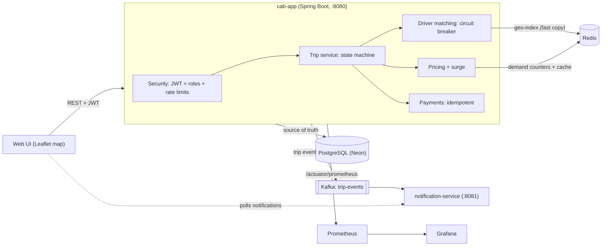

# CabGo: ride-hailing backend (Spring Boot)

A cab-booking system (Uber/Ola style) built to demonstrate **system design** fundamentals: geospatial matching,
concurrency control, event-driven architecture, caching, resilience and observability. Everything is free and runs locally.

**What you can do with it:** register as a rider or driver, request a ride from a map, get matched with the nearest free
driver, watch the trip move through its states, pay (idempotently), and rate the driver. A separate notification service
reacts to Kafka events, and Grafana shows live metrics.

> **Live demo:** _https://cabgo-ride-hailing-backend.onrender.com

## Architecture



### What happens when a rider requests a ride
1. **Rate limit** check (30/min per rider), validation, "one active trip" rule.
2. **Price** = (base + per-km) x **surge multiplier** (Redis demand counter vs. nearby driver supply, cached 20 s).
3. **Find candidates**: Redis geo-index returns the nearest AVAILABLE drivers. If Redis fails, a **circuit breaker** switches to a SQL (Haversine) search.
4. **Claim a driver atomically** with one SQL statement (`UPDATE ... WHERE status='AVAILABLE'`). Only one request can win a driver, even if two riders pick the same one at the same instant.
5. Trip is saved as `DRIVER_ASSIGNED` (or `NO_DRIVER_FOUND`). After the DB commit, a **Kafka event** is published; the notification service turns it into messages.

## Project structure (MVC / layered)
```
cab-app/src/main/java/com/example/cab
 |-- controller/   REST endpoints            (Auth, Driver, Rider, Trip, Payment, Config)
 |-- service/      business logic            (TripService, DriverService, PricingService, PaymentService, ...)
 |-- repository/   data access               (Spring Data JPA repositories + Redis DriverGeoIndex)
 |-- model/        JPA entities + enums      (Driver, Rider, Trip, Payment, Rating, AppUser, TripStatus, ...)
 |-- dto/          request/response objects  (TripResponse, RegisterRequest, FareQuote, ...)
 |-- exception/    custom exceptions + GlobalExceptionHandler
 |-- security/     CurrentUser (reads the JWT)
 |-- config/       SecurityConfig, KafkaTopicConfig
 |-- event/        TripEvent + Kafka publisher
 |-- gateway/      PaymentGateway interface + fake implementation
 |-- util/         GeoUtils
cab-app/src/main/resources/static   the web UI (the "View")
notification-service/               separate Kafka-consuming service
```
Flow of every request: **controller -> service -> repository -> model**.

## Tech stack (all free)
Java 21, Spring Boot 3.5 (Web, Data JPA, Security + OAuth2 resource server, Validation, Actuator), PostgreSQL (Neon free tier),
Redis, Apache Kafka (KRaft), Resilience4j, Micrometer + Prometheus + Grafana, JUnit 5 + Testcontainers, k6, Docker Compose,
Leaflet + OpenStreetMap for the UI.

## Quick start

**Prerequisites:** JDK 21, IntelliJ IDEA (Community is fine), Docker Desktop, a free [Neon](https://neon.tech) database.

1. **Database config.** Copy `cab-app/src/main/resources/application-local.properties.example` to
   `application-local.properties` (same folder) and fill in your Neon host, user and password
   (Neon console -> Connect -> **pooling OFF**). This file is git-ignored.
2. **Start infrastructure:** `docker compose up -d` (Redis, Kafka, Prometheus, Grafana).
3. **Open the project in IntelliJ** (File > Open > select the root `pom.xml` > Open as Project) and let Maven import.
4. **Run `CabApplication`** (port 8080) and **`NotificationApplication`** (port 8081) from the green play buttons.
5. Open **http://localhost:8080**.

### Try it (2 minutes)
1. On the login screen click **Seed 5 demo drivers** (they appear online around the map centre).
2. **Register as a rider**, click the map for pickup then drop, check the price, **Request ride**.
3. Open a second browser window (or a private window), click **Use** next to a demo driver to log in as them (password `password123`).
   When the trip is assigned to that driver: **Simulate: drive to pickup**, **Start trip**, **Simulate: drive to drop**, **Complete trip**.
4. Back on the rider window: **Pay**, then give a star rating.

| URL | What |
|---|---|
| http://localhost:8080 | The app |
| http://localhost:3000 | Grafana (admin / admin), dashboard "Cab booking - overview" |
| http://localhost:9090 | Prometheus |
| http://localhost:8080/actuator/prometheus | Raw metrics |

### Optional: run both apps in Docker too
Copy `.env.example` to `.env`, fill it in, then `docker compose --profile apps up -d --build`.

## Deploy for free
See **[docs/DEPLOYMENT.md](docs/DEPLOYMENT.md)** (GitHub + Neon + Render, no credit card). The cloud demo runs without Kafka
(`CAB_EVENTS_ENABLED=false`); the complete Kafka + notification + Grafana setup runs locally with `docker compose`.

## Tests
* **Unit tests** (no Docker): `TripStatusTest`, `GeoUtilsTest`, `SurgePricingServiceTest`.
* **Integration test** (needs Docker running): `CabFlowIntegrationTest` starts real PostgreSQL, Redis and Kafka with
  Testcontainers and checks the full flow, including **two simultaneous riders competing for one driver**
  (exactly one must win), idempotent payments, ratings, and 401/403/400 behaviour.
* Run them in IntelliJ (right-click the test folder > Run) or `mvn test` if you have Maven installed.

## Load test and benchmark (k6)
```bash
# Terminal 1: run the app with the slow SQL search (set env var CAB_MATCHING_STRATEGY=sql in IntelliJ's run config)
# Terminal 2:
docker run --rm -i -e BASE_URL=http://host.docker.internal:8080 grafana/k6 run - < loadtest/matching.js
# Then restart the app with CAB_MATCHING_STRATEGY=redis and run the same command again.
```
(PowerShell: `Get-Content loadtest/matching.js | docker run --rm -i -e BASE_URL=http://host.docker.internal:8080 grafana/k6 run -`)

| Strategy | Drivers | Trip-create p95 | Avg matching time | Notes |
|---|---------|-----------------|-------------------|---|
| sql (full scan) | 100     | 65.7 ms         | 97.5%             | |
| redis (geo-index) | 100     | 32.6 ms         | 97.7%             | |

### Resilience demo (great to show in an interview)
While the app is running: `docker stop <redis-container>` then request rides. Matching keeps working through the
SQL fallback, the Grafana panel *Redis circuit breaker state* flips to open, and the `sql_fallback` strategy
appears in the matching-duration chart. `docker start <redis-container>`: the breaker closes after ~10 seconds.

## API summary (all under `/api/v1`)
| Method + path | Who | Purpose |
|---|---|---|
| POST `/auth/register`, `/auth/login` | public | Create account / get JWT (login limited to 5/min per phone) |
| GET `/riders/me` | rider | Own profile |
| GET `/drivers/me` | driver | Own profile, status, rating |
| PUT `/drivers/me/location` | driver | Live location ping |
| PUT `/drivers/me/status` | driver | Go AVAILABLE / OFFLINE |
| POST `/trips/quote` | rider | Price preview (does not count as demand) |
| POST `/trips` | rider | Request a ride (auto-matches a driver) |
| GET `/trips/mine`, `/trips/{id}` | rider/driver | My trips (participants only) |
| POST `/trips/{id}/start`, `/complete` | assigned driver | Advance the trip |
| POST `/trips/{id}/cancel` | rider/driver | Cancel before the ride starts |
| POST `/trips/{id}/payment` | rider | Pay; header `Idempotency-Key` required |
| POST `/trips/{id}/rating` | rider | Rate the driver 1-5 |

Errors always look like `{"timestamp":..., "status":409, "error":"Conflict", "message":"..."}`.

## Design decisions and trade-offs
See **[docs/CONCEPTS.md](docs/CONCEPTS.md)** for every concept, where it lives in the code, and its alternatives. Highlights:
* **PostgreSQL is the source of truth; Redis is a rebuildable fast copy.** Redis is updated only after DB commits and is rebuilt on startup.
* **Atomic compare-and-swap in SQL** prevents double-assigning a driver (alternatives: distributed lock, `SELECT FOR UPDATE`).
* **Trip state machine** makes illegal transitions impossible; **optimistic locking** (`@Version`) catches concurrent edits.
* **Events are published after commit** (so Kafka never sees rolled-back changes).
* **Layered (MVC) monolith + one separate service**: services call other features' services, never their repositories, so features can be extracted into services later.

## Known limitations / future work
* **Outbox pattern**: an event can be lost if the app crashes between DB commit and Kafka send. The fix is a transactional outbox table.
* **Location pings also write to PostgreSQL** (needed for the SQL fallback). At real scale pings would go to Redis/Kafka only, with batched persistence.
* **Straight-line distance/ETA** instead of a routing engine (OSRM / Google Directions).
* **Polling** in the UI instead of WebSocket/SSE push.
* **Rate limiters are per instance** (in memory); use Redis for a cluster-wide limit.
* Not built: API gateway, service discovery, Kubernetes manifests, real payment provider (Stripe test mode is a drop-in via `PaymentGateway`), admin dashboard, Flyway migrations.


## Troubleshooting
| Problem | Fix |
|---|---|
| `password authentication failed` | Wrong Neon credentials in `application-local.properties` |
| Timeout connecting to the DB | Neon was asleep: wait 10 s and retry; use the direct (non-pooler) host |
| `release version 21 not supported` | IntelliJ SDK is not JDK 21 (File > Project Structure) |
| Map is blank | Needs internet for OpenStreetMap tiles and the Leaflet CDN |
| No notifications appear | `NotificationApplication` is not running or Kafka is down (`docker compose ps`) |
| Grafana shows "No data" | App not running yet; Prometheus needs a few seconds after the first request |
| After changing entities, startup errors about NOT NULL columns | Run `DROP TABLE IF EXISTS payments, ratings, trips, drivers, riders, app_users CASCADE;` in Neon's SQL editor |
